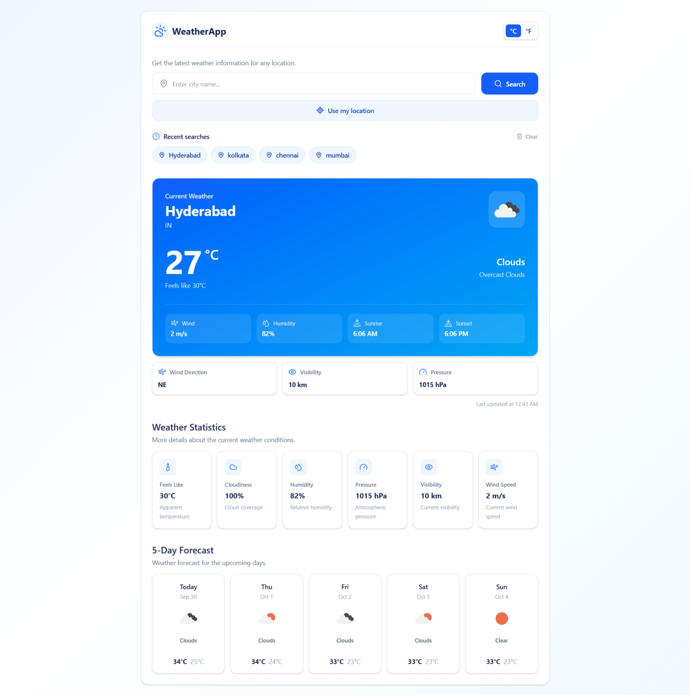
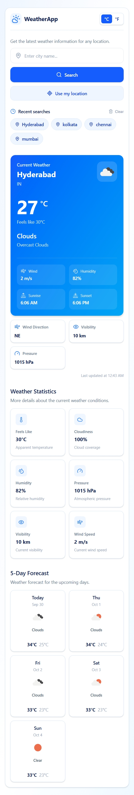

# 🌤️ Weather App

A responsive weather application built with React and Tailwind CSS that provides real-time weather information for cities around the world using the OpenWeather API.

## 🚀 Live Demo

[View Live Demo](https://weather-app-pi-black-87.vercel.app/)

## 📸 Screenshots

### Desktop



### Mobile



## ✨ Features

* 🔍 Search weather by city name
* 📍 Detect weather using the user's current location
* 🌡️ Switch between Celsius and Fahrenheit
* 🌤️ Display current weather conditions
* 📊 View detailed weather statistics
* 📅 5-day weather forecast
* 🕐 Display sunrise, sunset, and last updated time
* 💨 Wind speed and wind direction
* 💧 Humidity information
* 👁️ Visibility information
* 🌡️ Atmospheric pressure
* 🕘 Store recent searches using localStorage
* 🗑️ Clear recent searches
* ⚠️ User-friendly error states
* ⏳ Loading state while fetching weather data
* 📱 Fully responsive design for desktop, tablet, and mobile devices

## 🛠️ Tech Stack

* **React** — UI development
* **JavaScript** — Application logic
* **Tailwind CSS** — Styling and responsive design
* **OpenWeather API** — Weather data
* **Lucide React** — Icons
* **Vite** — Development and build tool
* **localStorage** — Recent search persistence
* **Geolocation API** — Current location detection

## 📂 Project Structure

```text
src/
├── components/
│   ├── Header.jsx
│   ├── SearchBar.jsx
│   ├── LocationButton.jsx
│   ├── EmptyState.jsx
│   ├── RecentSearches.jsx
│   ├── CurrentWeather.jsx
│   ├── WeatherStats.jsx
│   ├── Forecast.jsx
│   └── ForecastCard.jsx
│
├── services/
│   └── weatherApi.js
│
├── App.jsx
├── main.jsx
└── index.css
```

## 🔑 API

This project uses the **OpenWeather API** to retrieve current weather and forecast data.

The API key is stored in an environment variable instead of being committed to the repository.

```env
VITE_OPENWEATHER_API_KEY=your_api_key_here
```

## ⚙️ Getting Started

### 1. Clone the repository

```bash
git clone YOUR_GITHUB_REPOSITORY_URL
```

### 2. Navigate to the project

```bash
cd weather-app
```

### 3. Install dependencies

```bash
npm install
```

### 4. Create the environment file

Create a `.env` file in the project root:

```env
VITE_OPENWEATHER_API_KEY=your_api_key_here
```

Replace `your_api_key_here` with your OpenWeather API key.

### 5. Start the development server

```bash
npm run dev
```

The application will be available at the local development URL shown in your terminal.

## 🔄 How It Works

The application follows this basic flow:

```text
User searches for a city
        ↓
React sends request to OpenWeather API
        ↓
Weather data is received
        ↓
Application updates React state
        ↓
Weather components render the data
```

For location-based weather:

```text
User clicks "Use my location"
        ↓
Browser Geolocation API
        ↓
Latitude + Longitude
        ↓
OpenWeather API
        ↓
Weather information
```

## 💡 Key React Concepts Used

This project was built to practice and demonstrate:

* Functional components
* Props
* `useState`
* Asynchronous API requests
* Conditional rendering
* Event handling
* Component composition
* Local storage
* Browser Geolocation API
* Reusable UI components
* Responsive design

## 📱 Responsive Design

The application is designed to work across:

* Desktop
* Laptop
* Tablet
* Mobile devices

Tailwind CSS responsive utilities are used to adapt the layout to different screen sizes.


## 👨‍💻 Author

**Subhojit Dey**

Frontend Developer | React Developer

### Technologies

`HTML` `CSS` `JavaScript` `React` `Tailwind CSS` `Git` `GitHub`

---

⭐ If you found this project useful, feel free to explore the repository and try the live application.
